# Outpace: Advanced Strava Dashboard

Outpace is a comprehensive web application that enhances your Strava experience by providing advanced visualization and analytics features. Create personalized dashboards with multi-day trip detection, global activity heatmaps, detailed statistics, and more.

## Features

- **Multi-Day Trip Detection**: Automatically identifies and groups activities that form part of a longer journey
- **Global Heatmap**: Visualize all your activities on a single map to see your global footprint
- **Activity Statistics**: Get detailed insights into your performance metrics
- **Pinned Activities**: Highlight your favorite or most significant activities
- **Shareable Dashboards**: Generate links to share your dashboard with friends and family
- **Elevation Data**: Enhanced elevation profiles and statistics

## Architecture

The application follows a modern web architecture with a React frontend and FastAPI backend, using PostgreSQL for data storage.

```mermaid
graph TD
    %% User Interaction
    User[User] --> WebUI[React Web UI]
    
    %% Frontend Components
    WebUI --> Router[AppRouter]
    Router --> Pages[React Pages]
    Pages --> Components[React Components]
    
    %% Authentication Flow
    WebUI --> StravaAuth[Strava Authentication]
    StravaAuth --> StravaAPI[Strava API]
    StravaAPI --> StravaRedirect[Strava Redirect]
    StravaRedirect --> TokenRegistration[Register Token]
    
    %% Backend Services
    WebUI <--> FastAPI[FastAPI Backend]
    FastAPI --> Endpoints[API Endpoints]
    
    %% Database Interactions
    FastAPI --> Database[(PostgreSQL Database)]
    Database --> Models[Database Models]
    Models --> RefreshToken[RefreshToken Model]
    Models --> AthleteSLAT[AthleteSLAT Model]
    Models --> Activity[Activity Model]
    Models --> Trip[Trip Model]
    Models --> Dashboard[Dashboard Model]
    
    %% Core Functionality
    FastAPI --> ActivityProcessing[Activity Processing]
    ActivityProcessing --> TripDetection[Trip Detection]
    ActivityProcessing --> ElevationComputation[Elevation Computation]
    
    %% External Services
    ElevationComputation --> ExternalElevationAPI[External Elevation API]
    TripDetection --> Geocoding[Nominatim Geocoding]
    
    %% Dashboard Features
    WebUI --> DashboardView[Dashboard View]
    DashboardView --> Heatmap[Global Heatmap]
    DashboardView --> TripView[Trip View]
    DashboardView --> ActivityStats[Activity Statistics]
    DashboardView --> PinnedActivities[Pinned Activities]
    
    %% Data Sharing
    DashboardView --> ShareDashboard[Share Dashboard]
    ShareDashboard --> TokenGeneration[Token Generation]
    TokenGeneration --> SharedDashboard[Shared Dashboard URL]
    
    %% Background Tasks
    FastAPI --> BackgroundTasks[Background Tasks]
    BackgroundTasks --> FetchElevations[Fetch Elevations]
    BackgroundTasks --> ProcessActivities[Process Activities]
    
    %% Subgraphs for organization
    subgraph "Frontend (React)"
        WebUI
        Router
        Pages
        Components
        DashboardView
        Heatmap
        TripView
        ActivityStats
        PinnedActivities
        StravaRedirect
    end
    
    subgraph "Backend (FastAPI)"
        FastAPI
        Endpoints
        ActivityProcessing
        TripDetection
        ElevationComputation
        BackgroundTasks
        FetchElevations
        ProcessActivities
        TokenRegistration
        TokenGeneration
    end
    
    subgraph "Database (PostgreSQL)"
        Database
        Models
        RefreshToken
        AthleteSLAT
        Activity
        Trip
        Dashboard
    end
    
    subgraph "External Services"
        StravaAPI
        StravaAuth
        ExternalElevationAPI
        Geocoding
    end
    
    %% Styling
    classDef frontend fill:#f9f,stroke:#333,stroke-width:2px
    classDef backend fill:#bbf,stroke:#333,stroke-width:2px
    classDef database fill:#dfd,stroke:#333,stroke-width:2px
    classDef external fill:#ffd,stroke:#333,stroke-width:2px
    
    class Frontend,WebUI,Router,Pages,Components,DashboardView,Heatmap,TripView,ActivityStats,PinnedActivities,StravaRedirect frontend
    class Backend,FastAPI,Endpoints,ActivityProcessing,TripDetection,ElevationComputation,BackgroundTasks,FetchElevations,ProcessActivities,TokenRegistration,TokenGeneration backend
    class Database,Models,RefreshToken,AthleteSLAT,Activity,Trip,Dashboard database
    class External,StravaAPI,StravaAuth,ExternalElevationAPI,Geocoding external
```



## Run locally

You need Docker Compose and a Strava API application. In the Strava application
settings, set the authorization callback domain to `localhost`.

Create a root `.env` file (it is ignored by Git):

```dotenv
CLIENT_ID=your_strava_client_id
CLIENT_SECRET=your_strava_client_secret

# Optional: needed for Mapbox-backed map tiles
REACT_APP_MAPBOX_ACCESS_TOKEN=your_mapbox_token

# Optional: needed for Cesium elevation lookups
REACT_APP_ION_DEFAULT_ACCESS_TOKEN=your_cesium_ion_token
```

Then build and start the complete stack:

```console
docker compose up --build -d
```

Open [http://localhost:3000](http://localhost:3000). The API and its interactive
documentation are available at [http://localhost:8000/docs](http://localhost:8000/docs).

### Static demo

The **See a demo!** button works without Strava or PostgreSQL data. Its fixture is
generated from the checked-in StatsHunters export:

```console
python3 scripts/build_demo_data.py \
  StatsHunters-Export-2026-08-20.xlsx \
  front/public/demo-data.json \
  --gpx-dir trip1 --gpx-dir trip2 --gpx-dir trip3 --gpx-dir trip4 \
  --pinned-dir pinned
```

The fixture powers cycling and running distance/elevation rankings. Optional GPX
directories add route geometry and multi-day trip cards to the same static demo.
The optional pinned directory populates the pinned-activity carousel.

PostgreSQL data is kept in a named Docker volume, so normal container restarts do
not erase imported activities. Useful commands:

```console
docker compose logs -f
docker compose down
docker compose down -v # also deletes the local database
```

The Strava client secret is used only by the backend and is never included in the
frontend JavaScript bundle.

## Usage

1. Open the application in your browser
2. Log in with your Strava account
3. Allow the application to access your Strava data
4. Your activities will be automatically imported and processed
5. Explore your personalized dashboard with trips, heatmaps, and statistics
6. Share your dashboard using the generated link

## Development

### Project Structure

- `front/`: React frontend application
- `back/`: FastAPI backend application
- `docker-compose.yml`: Docker configuration for development

### Contributing

Contributions are welcome! Please feel free to submit a Pull Request.
